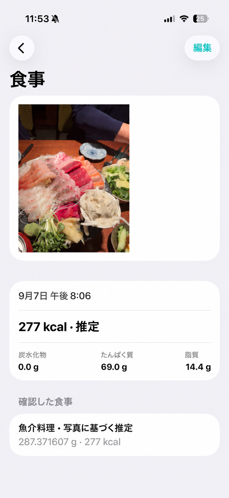
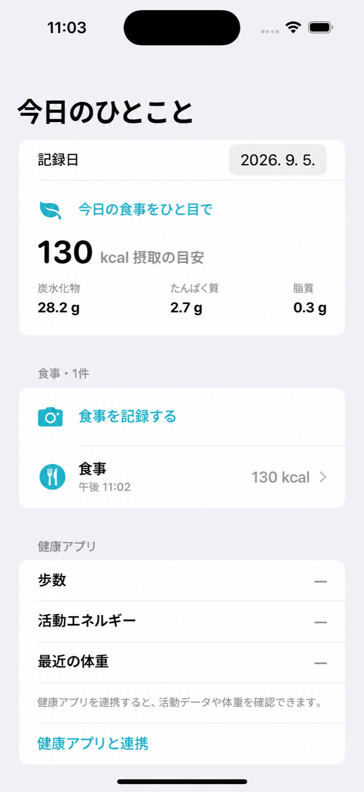
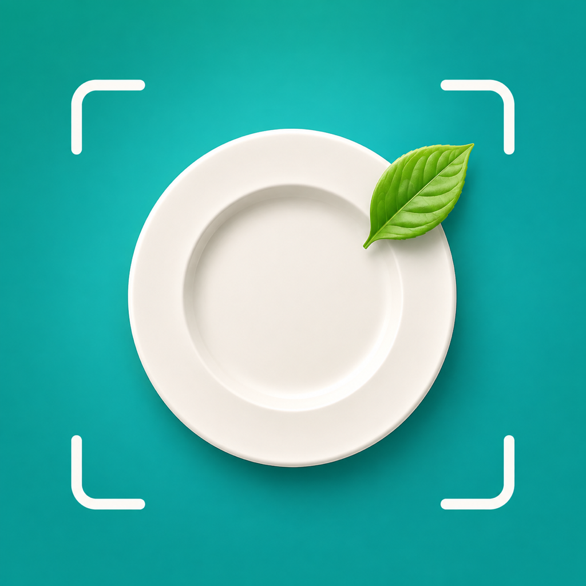

# 한 끼 · MealLens

[日本語](README.ja.md) · [English](README.md) · [한국어](README.ko.md)

写真を撮ると、デバイス内で食べ物の種類と食べた量を推定し、推定カロリーと栄養素を計算するiOSアプリです。 SwiftUI、Vision、Core ML、HealthKit、Photos、SwiftDataのみを使用し、外部AI APIに写真を送信しません。

## 画面プレビュー

<table>
  <tr>
    <td></td>
    <td></td>
    <td></td>
  </tr>
</table>

## の使い方

1.ダッシュボードで**食事を記録する**をタップします。
2.写真を撮るか、写真ライブラリから食べ物の写真を選びます。
3. Core MLモデルが食べ物の種類を見つけ、アプリが写真と食べ物の種類に基づいて食べた量を推定します。
4. 食品名はハングルで表示されます。食べ物名・重量・食べた量全体のカロリーを直接修正できます。重量を変えるとカロリーも比例して変わります。
5. 保存すると、今日のカロリーと炭水化物・タンパク質・脂肪の合計に反映されます。

写真分析モデルが実行されると、写真から皿全体の重量・熱量を推定します。モデルが利用できない場合にのみ、食品ごとの代表量をフォールバックとして適用し、結果画面に適用した方法を表示します。どちらの方法も推定値なので、ユーザーは重量を変更できます。

## 主な機能

- 写真選択・カメラ撮影・写真再分析
- 写真ベースの食品名・重量・カロリー自動推定
- 食べ物と重量を直接修正できる編集画面
- 1日ごとの食事の合計と食事の詳細・修正・削除
- HealthKit歩数・活動エネルギー・最近の体重を読む
- SwiftDataローカル保存
- 韓国語のネイティブUIとアプリのアイコン

アプリを削除せずに更新すると、既存の履歴と写真が保持されます。履歴と写真はデバイスに保存され、アプリを削除すると一緒に削除されます。

## プロジェクト構造

|ファイル|役割|
| --- | --- |
| `MealLens/MealLensApp.swift` |アプリの起動とSwiftDataコンテナ|
| `MealLens/DashboardView.swift` |今日の合計と健康データ|
| `MealLens/MealEditorView.swift` |写真分析、自動推定、食事の保存|
| `MealLens/FoodClassifier.swift` | Vision / Core MLオンデバイス推論
| `MealLens/Nutrition.swift` |食品カタログと写真ベースの羊と栄養の推定
