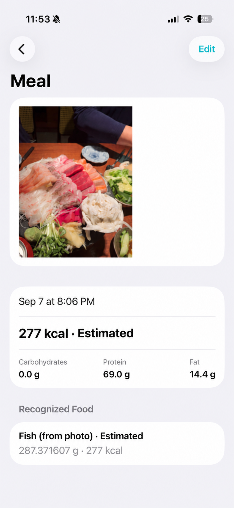
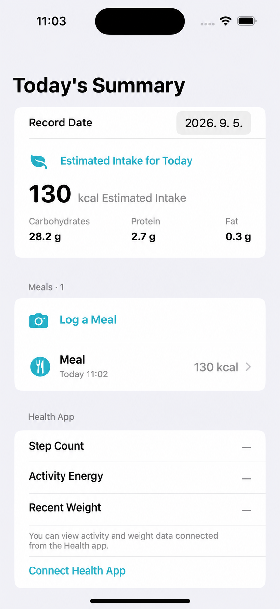
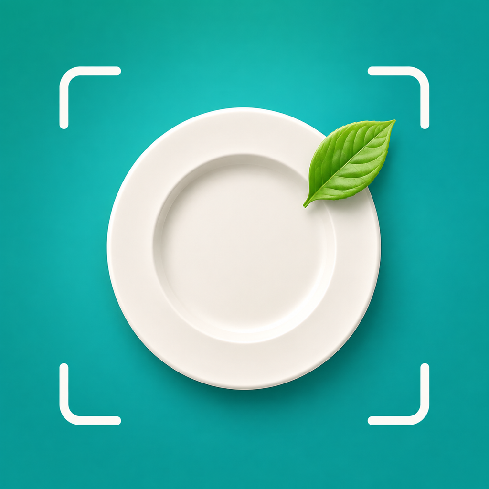

# 한 끼 · MealLens

[日本語](README.ja.md) · [English](README.md) · [한국어](README.ko.md)

This is an iOS app that takes a photo and estimates the type of food and the amount eaten within the device, and calculates estimated calories and nutrients. It only uses SwiftUI, Vision, Core ML, HealthKit, Photos, and SwiftData and does not send photos to external AI APIs.

## Screen preview

<table>
  <tr>
    <td></td>
    <td></td>
    <td></td>
  </tr>
</table>

## How to use

1. Tap **Record Meals** on your dashboard.
2. Take a photo or select a photo of your food from your photo library.
3. The Core ML model finds the type of food, and the app estimates the amount eaten based on the photo and type of food.
4. Food names are displayed in Korean. You can directly edit the food name, weight, and total calories of the amount eaten. When you change weight, calories change proportionally.
5. When saved, it will be reflected in today's total calories, carbohydrates, protein, and fat.

When the photo analysis model is run, the weight and calories of the entire dish are estimated from the photo. Only when the model is not available, the representative amount for each food is applied as a fallback, and the applied method is displayed on the results screen. Both methods are estimates so the weight can be modified by the user.

## Main features

- Photo selection, camera shooting, photo re-analysis
- Automatic estimation of food name, weight, and calories based on photo
- Edit screen where you can directly edit food and weight
- Daily meal total and meal details/edit/delete
- HealthKit steps, activity energy, and recent weight reading
- SwiftData local storage
- Korean native UI and app icons

If you update the app without deleting it, your existing history and photos will be kept. Your records and photos are stored on your device and are deleted when you delete the app.

## Project structure

| file | Role |
| --- | --- |
| `MealLens/MealLensApp.swift` | App launch and SwiftData container |
| `MealLens/DashboardView.swift` | Today's Totals and Health Data |
| `MealLens/MealEditorView.swift` | Photo analysis, automatic estimation, meal saving |
| `MealLens/FoodClassifier.swift` | Vision/Core ML on-device inference |
| `MealLens/Nutrition.swift` | Quantity and nutrition estimation based on food catalogs and photos |
