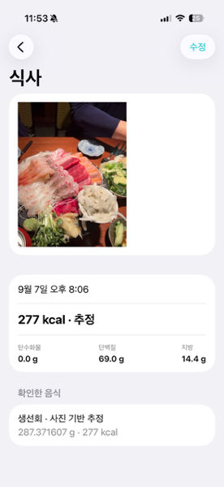
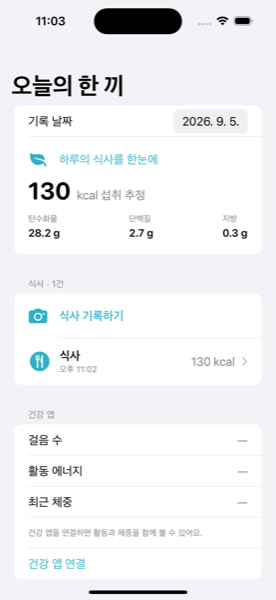

# 한 끼 · MealLens

[日本語](https://github.com/hjy0221/MealLens#%E6%97%A5%E6%9C%AC%E8%AA%9E) · [English](https://github.com/hjy0221/MealLens#english) · [한국어](https://github.com/hjy0221/MealLens#%ED%95%9C%EA%B5%AD%EC%96%B4)

## 日本語

写真を撮ると、デバイス内で食べ物の種類と食べた量を推定し、推定カロリーと栄養素を計算するiOSアプリです。 SwiftUI、Vision、Core ML、HealthKit、Photos、SwiftDataのみを使用し、外部AI APIに写真を送信しません。

## 画面プレビュー

<table>
  <tr>
    <td></td>
    <td></td>
    <td></td>
  </tr>
</table>

## の使い方

1.ダッシュボードで**食事を記録する**をタップします。
2.写真を撮るか、写真ライブラリから食べ物の写真を選びます。
3. Core MLモデルが食べ物の種類を見つけ、アプリが写真と食べ物の種類に基づいて食べた量を推定します。
4. 食品名はハングルで表示されます。食べ物名・重量・食べた量全体のカロリーを直接修正できます。重量を変えるとカロリーも比例して変わります。
5. 保存すると、今日のカロリーと炭水化物・タンパク質・脂肪の合計に反映されます。

写真分析モデルが実行されると、写真から皿全体の重量・熱量を推定します。モデルが利用できない場合にのみ、食品ごとの代表量をフォールバックとして適用し、結果画面に適用した方法を表示します。どちらの方法も推定値なので、ユーザーは重量を変更できます。

## 主な機能

- 写真選択・カメラ撮影・写真再分析
- 写真ベースの食品名・重量・カロリー自動推定
- 食べ物と重量を直接修正できる編集画面
- 1日ごとの食事の合計と食事の詳細・修正・削除
- HealthKit歩数・活動エネルギー・最近の体重を読む
- SwiftDataローカル保存
- 韓国語のネイティブUIとアプリのアイコン

アプリを削除せずに更新すると、既存の履歴と写真が保持されます。履歴と写真はデバイスに保存され、アプリを削除すると一緒に削除されます。

## プロジェクト構造

|ファイル|役割|
| --- | --- |
| `MealLens/MealLensApp.swift` |アプリの起動とSwiftDataコンテナ|
| `MealLens/DashboardView.swift` |今日の合計と健康データ|
| `MealLens/MealEditorView.swift` |写真分析、自動推定、食事の保存|
| `MealLens/FoodClassifier.swift` | Vision / Core MLオンデバイス推論
| `MealLens/Nutrition.swift` |食品カタログと写真ベースの羊と栄養の推定

## English

This is an iOS app that takes a photo and estimates the type of food and the amount eaten within the device, and calculates estimated calories and nutrients. It only uses SwiftUI, Vision, Core ML, HealthKit, Photos, and SwiftData and does not send photos to external AI APIs.

## Screen preview

<table>
  <tr>
    <td></td>
    <td></td>
    <td></td>
  </tr>
</table>

## How to use

1. Tap **Record Meals** on your dashboard.
2. Take a photo or select a photo of your food from your photo library.
3. The Core ML model finds the type of food, and the app estimates the amount eaten based on the photo and type of food.
4. Food names are displayed in Korean. You can directly edit the food name, weight, and total calories of the amount eaten. When you change weight, calories change proportionally.
5. When saved, it will be reflected in today's total calories, carbohydrates, protein, and fat.

When the photo analysis model is run, the weight and calories of the entire dish are estimated from the photo. Only when the model is not available, the representative amount for each food is applied as a fallback, and the applied method is displayed on the results screen. Both methods are estimates so the weight can be modified by the user.

## Main features

- Photo selection, camera shooting, photo re-analysis
- Automatic estimation of food name, weight, and calories based on photo
- Edit screen where you can directly edit food and weight
- Daily meal total and meal details/edit/delete
- HealthKit steps, activity energy, and recent weight reading
- SwiftData local storage
- Korean native UI and app icons

If you update the app without deleting it, your existing history and photos will be kept. Your records and photos are stored on your device and are deleted when you delete the app.

## Project structure

| file | Role |
| --- | --- |
| `MealLens/MealLensApp.swift` | App launch and SwiftData container |
| `MealLens/DashboardView.swift` | Today's Totals and Health Data |
| `MealLens/MealEditorView.swift` | Photo analysis, automatic estimation, meal saving |
| `MealLens/FoodClassifier.swift` | Vision/Core ML on-device inference |
| `MealLens/Nutrition.swift` | Quantity and nutrition estimation based on food catalogs and photos |

## 한국어

사진을 찍으면 기기 안에서 음식 종류와 먹은 양을 추정하고, 예상 칼로리와 영양소를 계산하는 iOS 앱입니다. SwiftUI, Vision, Core ML, HealthKit, Photos, SwiftData만 사용하며 외부 AI API로 사진을 보내지 않습니다.

## 화면 미리보기

<table>
  <tr>
    <td></td>
    <td></td>
    <td></td>
  </tr>
</table>

## 사용 방법

1. 대시보드에서 **식사 기록하기**를 누릅니다.
2. 사진을 찍거나 사진 보관함에서 음식 사진을 고릅니다.
3. Core ML 모델이 음식 종류를 찾고, 앱이 사진과 음식 종류를 바탕으로 먹은 양을 추정합니다.
4. 음식 이름은 한글로 표시됩니다. 음식 이름·중량·먹은 양 전체의 칼로리를 직접 수정할 수 있습니다. 중량을 바꾸면 칼로리도 비례해서 바뀝니다.
5. 저장하면 오늘의 칼로리와 탄수화물·단백질·지방 합계에 반영됩니다.

사진 분석 모델이 실행되면 사진에서 접시 전체의 중량·열량을 추정합니다. 모델을 사용할 수 없는 경우에만 음식별 대표량을 fallback으로 적용하며, 결과 화면에 적용한 방식을 표시합니다. 두 방식 모두 추정값이므로 사용자가 중량을 수정할 수 있습니다.

## 주요 기능

- 사진 선택·카메라 촬영·사진 다시 분석
- 사진 기반 음식명·중량·칼로리 자동 추정
- 음식과 중량을 직접 수정할 수 있는 편집 화면
- 하루별 식사 합계와 식사 상세·수정·삭제
- HealthKit 걸음 수·활동 에너지·최근 체중 읽기
- SwiftData 로컬 저장
- 한국어 네이티브 UI와 앱 아이콘

앱을 삭제하지 않고 업데이트하면 기존 기록과 사진이 유지됩니다. 기록과 사진은 기기에 저장되며 앱을 삭제하면 함께 삭제됩니다.

## 프로젝트 구조

| 파일 | 역할 |
| --- | --- |
| `MealLens/MealLensApp.swift` | 앱 시작과 SwiftData 컨테이너 |
| `MealLens/DashboardView.swift` | 오늘의 합계와 건강 데이터 |
| `MealLens/MealEditorView.swift` | 사진 분석, 자동 추정, 식사 저장 |
| `MealLens/FoodClassifier.swift` | Vision/Core ML 온디바이스 추론 |
| `MealLens/Nutrition.swift` | 음식 카탈로그와 사진 기반 양·영양 추정 |
